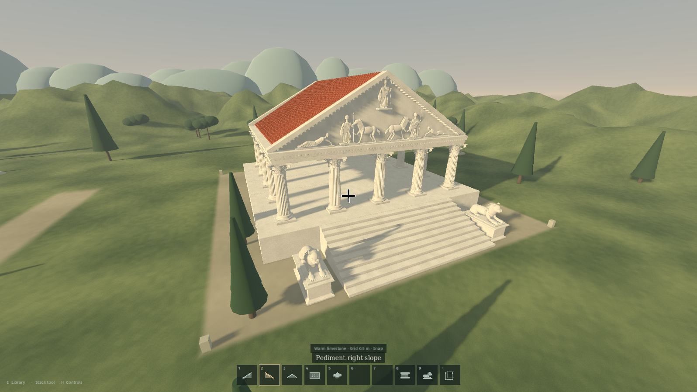

# Arcadia — Classical Builder

A first-person sandbox for building classical architecture. Lay out a temple, raise a colonnade, sculpt its silhouette with modular pediments, and finish the entrance with stone lions—all in a quiet landscape with moving sunlight.



Arcadia is a native **Godot** game, currently a **single-player Creative prototype for Linux**. Creative provides unlimited building materials, flight and undo/redo. Survival appears in the menu as **Coming later** and is not playable yet. The game runs locally and needs no account or online service.

## Play

### Run from source

Clone the repository, download the pinned Godot engine, and launch:

```bash
git clone git@github.com:tefaz/Arcadia-classical-architecture-game.git
cd Arcadia-classical-architecture-game
bash tools/setup.sh
./tools/Godot_v4.7.2-stable_linux.x86_64 --headless --editor --path . --import
./launch.sh
```

The setup script needs **Bash, curl and unzip** and downloads Godot **4.7.2** into `tools/`. The import command prepares fonts, assets and script classes for the first launch; on ARM64, replace `x86_64` in that command with `arm64`. Alternatively, open `project.godot` in an installed Godot 4.7.2 editor and run the main scene. The project declares Godot 4.5 compatibility, but the tested version is 4.7.2.

Click **Enter sanctuary** to explore the starter Ionic pavilion, or choose **Begin an empty sanctuary** for a clear plot. Press **E** to open the building library and **Esc** to pause and release the mouse.

`launch.sh` prefers the exported game in `builds/Arcadia-Linux` when one exists. After editing the source, run through the editor or rebuild that export to see your changes.

### Run a portable build

If you have built or received `Arcadia-Linux-x86_64.tar.gz`, extract it, keep its files together, and run:

```bash
cd Arcadia-Linux
./play.sh
```

The portable build includes the runtime; playing it does not require Godot, Python or an internet connection. Generated executables and archives are not stored in this source repository. See [Build a portable game](#build-a-portable-game) to create them.

**Tested platform:** x86-64 Linux, with X11 or Wayland and an OpenGL 3.3 / OpenGL ES 3.0 capable graphics driver. The setup script also supports an ARM64 Linux engine, but ARM64 has not been tested here and the export preset targets x86-64. Settings include graphics quality, field of view, mouse sensitivity, sound and brightness in shade. Use the **Simple** graphics profile to disable shadows.

## What you can build

The library contains **39 components**, with **warm limestone, white marble and golden sandstone** finishes. Terracotta roofs retain their tile colour.

| Category | Pieces and behaviour |
| --- | --- |
| Foundations | Repeatable masonry blocks, raised terraces, temple podiums, paving and stair supports. Stairs automatically fit the height and direction of a foundation landing. |
| Columns | Complete Doric, Ionic and Corinthian columns, including their bases, fluted shafts and carved capitals. Placement guides help establish consistent four-metre bays. |
| Walls and openings | Ashlar walls, open arches, and window walls with triangular, curved or elliptical decoration. Windows and doorways have real openings. |
| Entablatures and trim | Beams, dentil cornices and balustrades with automatic right-angle mitres and fitted closing spans. Walls can sit flush with foundation edges. |
| Pediments | Left/right slopes, crowns, backing and base cornices for large gables. Connected slopes form continuous diagonals and follow the outer entablature corners. |
| Roofs and ceilings | Rotatable terracotta and stone slopes, smaller half slopes, flat ceilings and hollow domes. Ceilings fit between pediments and beneath sloped roofs, including offset tile grids. |
| Sculpture and details | Draped and reclining figures, horse reliefs, a full lion statue, square and rectangular pedestals, urns and palmette finials. |

Most structural bays are **4 m** wide. Doric and Ionic columns are **4.1 m** tall; Corinthian columns are **4.3 m**. Adjustable wall and beam spans range from **0.5 to 8 m**. Use the same column order along a run to keep the roof support plane level.

For step-by-step placement, dimensions, roofs, window corners and sculpture attachments, read the [building guide](docs/building-guide.md).


## Your first temple

1. Place foundations edge to edge. Aim at a foundation’s side with **Temple steps** selected to create stairs up to its landing.
2. Open **E**, drag a column into your hotbar, and place columns on the marked bay centres. Double-tap **Space** to fly when working above ground.
3. Select **Entablature** and aim at a column top. Its end attaches to the support; **R** turns the next run and **T** reverses the anchor. Corners and closing spans fit automatically.
4. Add pediments on two opposite sides, then attach roof slopes behind them. Rotate a roof slope **180°** for the opposite side.
5. Fill underneath with **Flat roof / ceiling** panels. If the roof hides the entablature top, aim at its room-facing side. New infill follows nearby ceiling panels; side snapping or Stack fills larger areas. You can build the roof or ceiling first.
6. Add statues and trim, then press **F5** to save. **Ctrl+Z** undoes a placement or removal.

A green preview is ready to place; a coral preview reports a conflict. Solid overlaps, duplicates and placement through the player are blocked. Pieces can float while experimenting; there is no structural-collapse simulation.

## Controls

| Action | Control |
| --- | --- |
| Move / look | **WASD** / mouse |
| Sprint | Double-tap **W** and hold the second press; **Shift** also sprints on foot |
| Jump / rise in flight | **Space** |
| Descend in flight | **Shift** |
| Toggle flight | Double-tap **Space**, or **F** |
| Place / remove | Left / right mouse button |
| Pick the aimed component and finish | Middle mouse button |
| Select hotbar slot | **1–9** or mouse wheel |
| Open / close library | **E**, **B** or **Tab** |
| Rotate | **R**: 90°; **Shift+R**: 15° |
| Cycle attachment anchor / stone finish | **T** / **M** |
| Raise / lower preview | **Page Up** / **Page Down**; **Q** also lowers |
| Reset preview height | **Home** |
| Shorten / lengthen adjustable spans | **,** / **.** |
| Restore automatic span fitting | **/** |
| Toggle grid / component sockets | **G** / **C** |
| Temporarily bypass snapping | Hold **Alt** |
| Decrease / increase placement reach | **[** / **]** |
| Undo / redo | **Ctrl+Z** / **Ctrl+Y**; **Ctrl+Shift+Z** also redoes |
| Save / load | **F5** / **F9** |
| Equip Stack tool | **−**, mouse wheel or the library hotbar |
| Toggle quick help / fullscreen | **H** / **F11** |
| Pause / release mouse | **Esc** |

Flight has gentle acceleration and momentum. WASD movement stays horizontal while you look up or down. The crosshair adjusts against bright and dark backgrounds to remain visible.

### Hotbar and empty hands

The hotbar has **nine editable slots** and a fixed **Stack tool**. Drag library cards into slots, drag between slots to swap them, or drag a component outside the hotbar to empty its slot. **Clear slots 1–9** empties the building slots together. Select an empty slot for empty hands; you can still aim at a component and right-click to delete it. Middle-click selects the matching hotbar item or puts it into your current building slot, preserving its finish.

### Repeat an assembly with Stack

Equip **Stack**, left-click the first component, then right-click the last. The endpoint highlights are red and green; individual outlines show the selection. Select the same component twice to repeat only that piece.

Look along the direction you want to repeat, then scroll forward for copies toward that direction or backward for copies away from it. Look up or down to stack vertically. **Right-click confirms**, **left-click or Esc cancels**, and undo removes a confirmed batch as one action. The tool allows up to **32 repeated sets** and **256 preview components**; an obstructed copy blocks the batch.

## Saves and daylight

The current sanctuary loads on startup. Building changes autosave every **90 seconds**; **F5** saves manually. Saves include placed pieces, player position and flight state, the hotbar, selected finish, snap preferences and daylight phase. Undo/redo history is session-only.

On Linux, the default save folder is:

```text
~/.local/share/godot/app_userdata/Arcadia — Classical Builder/
```

If `XDG_DATA_HOME` is set, Godot uses that data root instead of `~/.local/share`.

- `sanctuary.json` — current world.
- `sanctuary.json.bak` — previous save, kept as a backup.
- `settings.cfg` — local settings.

To restore a backup, quit the game, copy the `.bak` file over `sanctuary.json`, and relaunch. Starting an empty sanctuary replaces the saved building when the next manual save or autosave occurs. Older component IDs and hotbars are migrated on load without moving existing pieces.

A **20-minute daylight cycle** moves from morning to sunset, then immediately returns to morning. It pauses in menus and the library. There is no night phase.

## Development

The project uses **Godot 4.7.2**, GDScript and the **GL Compatibility** renderer. Architecture, sculpture, scenery, material shaders, icons and short sound effects are generated by the source code. There are no external game-art packs or online gameplay services.

```bash
# Download the engine, if needed.
bash tools/setup.sh

# Import the project and open the editor.
./tools/Godot_v4.7.2-stable_linux.x86_64 --editor --path .

# Run the regression suite.
bash tests/run.sh
```

Tests use temporary data directories and do not load or overwrite your personal sanctuary. They exercise mesh closure and normals, collision, native input, placement and fitting, material selection, flight and sprinting, hotbar interaction, save/load, history, stacking and ceiling-preview performance. The current suite contains **3,191 checks**.

| Path | Purpose |
| --- | --- |
| `src/building/` | Component catalogue, procedural geometry, snapping, fitting, history and saves |
| `src/player/` | First-person movement, flight and sprinting |
| `src/ui/` | Library, hotbar, HUD, menus, icons and sounds |
| `src/world/` | Landscape, lighting, daylight cycle and example buildings |
| `tests/` | Headless gameplay, geometry and performance regressions |
| `tools/` | Engine setup, export helpers and portable launcher |
| `docs/` | Building guide, architecture notes, screenshots and third-party notices |

See [architecture notes](docs/architecture.md) for implementation details. To make a reproducible screenshot in an isolated example world:

```bash
./tools/Godot_v4.7.2-stable_linux.x86_64 --path . -- \
  --capture /tmp/arcadia-lions.png --lions --lion-detail
```

Capture mode does not load or save your personal world. Other example flags include `--roofs`, `--pediments`, `--enclosed-roof --interior` and `--corinthian --capital-detail`.

### Build a portable game

On x86-64 Linux:

```bash
bash tools/package.sh
```

The first export downloads the matching Linux release template. The export helper also needs **Python 3**, alongside **curl**, **unzip** and **tar**. Outputs are:

```text
builds/Arcadia-Linux/                  # Run ./play.sh inside this folder
builds/Arcadia-Linux-x86_64.tar.gz      # Share the complete portable game
```

Keep the executable, `.pck`, launcher and bundled notices together. Engine downloads, editor caches and generated builds are ignored by Git. `Arcadia.desktop` is a convenience launcher for the original checkout; update its `Exec` and `Icon` paths before using it elsewhere.

## Credits and third-party notices

Created by **Mads Nørgaard**. The project includes Godot’s MIT license and dependency notices, plus the licenses for the bundled Fira Sans and DejaVu fonts. See [third-party notices](docs/NOTICES.md) for details; portable builds include the corresponding license files.
