# Building guide

Detailed placement tips for Arcadia’s modular architecture. For installation, controls and saving, see the [README](../README.md).

## What you can build

The catalogue contains 39 components: purpose-built foundations and paving, stair supports, temple steps, complete Doric / Ionic / Corinthian columns, entablatures, modular pediments, ashlar walls, round arches, terracotta and stone roofs, hollow domes, dentil cornices, balustrades, pedestals, garden urns, palmette finials, and human, horse and lion sculpture. Choose warm limestone, white marble, or golden sandstone. Terracotta roofs retain their tiles; stone roofs and domes use the selected stone finish.

Pieces share metre-based dimensions and bottom-centred pivots. A standard column is 4.1 m tall, matching a wall or arch bay. Foundations are 4 × 4 m; beam and roof modules default to 4 m. Walls, entablatures, cornices, and balustrades automatically shorten to close matching gaps and also support lengths from 0.5 to 8 m in 0.5 m steps. The Corinthian order has a taller, 4.3 m column to accommodate its leaf capital.

| Foundation | Footprint | Height | Purpose |
| --- | --- | --- | --- |
| Foundation | 4 × 4 m | 0.4 m | One flush masonry course; repeat on all three axes |
| Paved walkway | 8 × 4 m | 0.4 m | Bordered approach with large rectangular paving flags |
| Courtyard paving | 8 × 8 m | 0.4 m | Broad paved court with a central diamond pattern |
| Raised terrace | 4 × 4 m | 0.8 m | Two flush 0.4 m masonry courses |
| Temple podium | 4 × 4 m | 2 m | Five flush 0.4 m masonry courses; repeat to enlarge |
| Stair support | 4 × 2 m | 0.4 m | Plain structural block beneath raised stairs |

The **Foundations** library filter groups these pieces with temple steps. Structural foundations share flush outer faces and 0.4 m stone courses, so repeating them horizontally or vertically makes a continuous masonry foundation, with shallow staggered joints instead of projecting feet or crowns. Walkway and courtyard pieces retain their decorative paving patterns.

Columns include their moulded foot, fluted shaft, and capital as one component. While placing a complete column on a foundation, **marked centres and dashed guide lines** show a **4 m bay grid**. Approximate aim snaps to those centres, so rectangular rows line up with standard entablatures. The first column uses the platform's bay centres; following columns match compatible columns already on the same connected platform, including rotated and off-grid builds. The layout stays on the aimed foundation. Hold **Alt** for free placement; grid/snap toggles and manual height offsets also bypass the guide.

To build the ring, place columns on the marked centres, equip **Entablature**, and aim at a column's top. The default attachment now puts a **beam end** on the column, so a 4 m beam reaches the next marked centre without cycling anchors first. **R** turns the run at a corner; **T** reverses the attached end. Corner profiles and the final closing span still fit automatically. The HUD shows the active column grid and beam-end attachment.

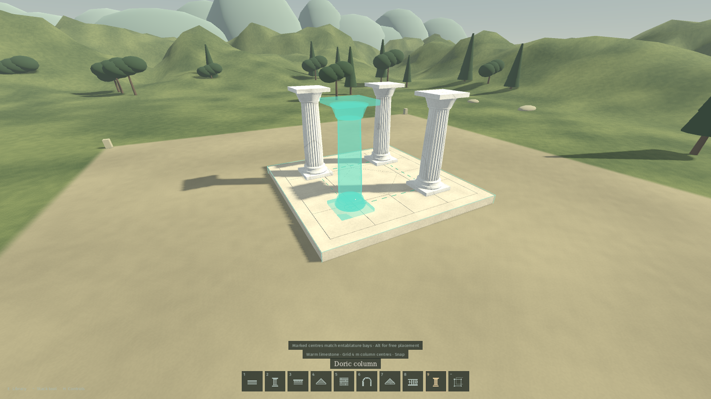

The Attic base was that column foot; separate bases, shafts, and capitals are retired from the library. Existing placed parts stay in saved buildings, and old hotbar assignments switch to the corresponding complete column.

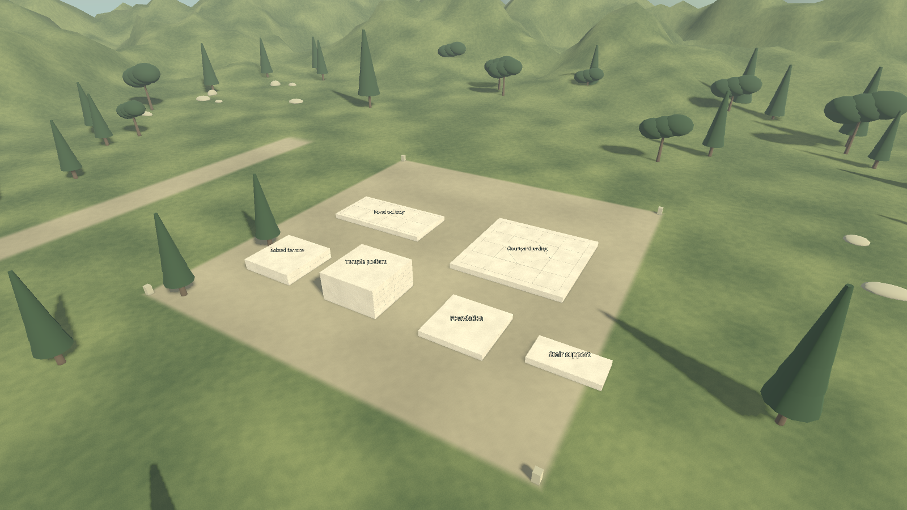

Foundation edges align their bases, including when neighboring pieces have different heights. Larger platforms include edge and support sockets on four-metre bays. Stair supports fill the space below raised temple steps and can stack in 0.4 m courses; you can also aim at an existing stair's underside to snap a support directly beneath it. Equip **Temple steps** and aim at the **side of the foundation at the desired landing height**. The stairway automatically faces that edge and extends from the ground to the exact platform top: a 0.4 m slab needs two steps, a 0.8 m terrace four, a 2 m podium ten, and a 2.4 m assembly twelve. The run grows with the height, keeping risers at most 0.2 m and treads 0.5 m deep. The stair body is solid down to the ground, so no separate supports or height nudges are needed. Repeat stairways sideways for wider entrances. A blocked entrance stays blocked; clear space for the full run. Ground placement retains the original 0.8 m four-step flight, and disabling sockets or adding a manual elevation offset bypasses automatic landing fitting.

## Doric and Ionic column detail

The **Doric column** has a smoothly rounded cushion, fine neck rings and a restrained, chamfered abacus. The **Ionic column** has solid spiral volutes with carved eyes, side bolsters and moulded belts, egg-and-dart ornament and a beaded neck. The Ionic carving is informed by [the Soane Museum’s marble capital fragment](https://collections.soane.org/object-m15).

Both retain their **4.1 m** height, attachment points and stone finishes. Existing columns and legacy capitals update automatically.

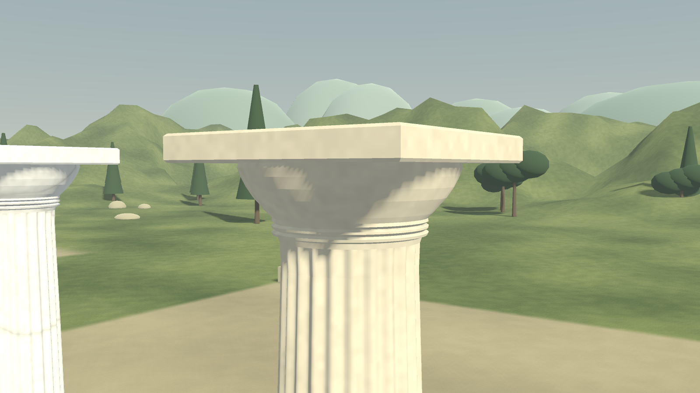

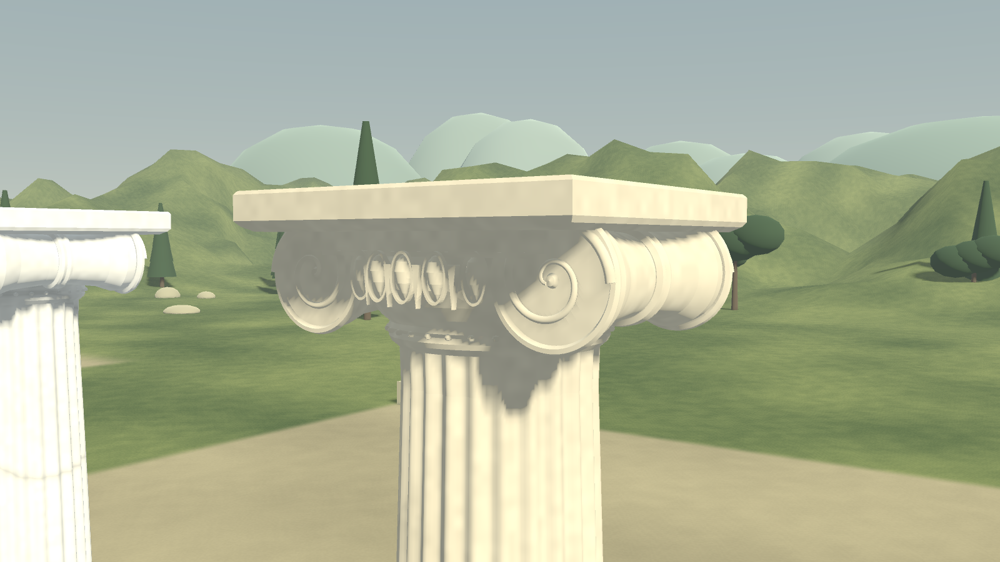

## Corinthian column detail

The **Corinthian column** has a carved bell capital with two staggered crowns of lobed, veined acanthus leaves, four corner volutes, smaller inward scrolls, flowers, and a moulded abacus with concave sides. **M** selects limestone, marble, or sandstone. Existing Corinthian columns and legacy capitals update automatically; the original **4.3 m** complete-column height and attachment points stay the same.

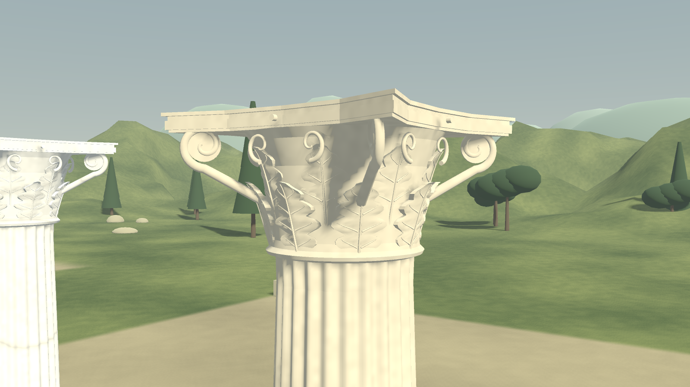

## Lion statue and rectangular pedestal

Find **Rectangular pedestal** in **Details** and **Lion statue** in **Sculpture**. The plinth is **3.2 × 1.6 m**, **1.2 m** high; the reclining lion has a raised head, swept mane, paws and a curled tail on its own shallow base. Aim at the pedestal’s top to centre the statue. Both are separate pieces, so you can also use the pedestal for other ornaments or place the lion on another suitable surface. **R** rotates each piece and **M** selects limestone, marble or sandstone.

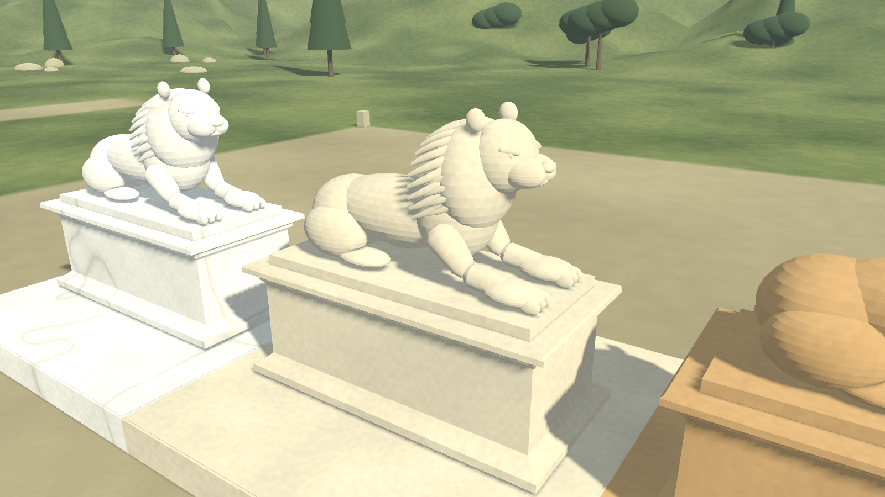

## Classical window walls

Open **E → Structure** for **Pediment window wall**, with a rectangular opening and triangular pediment, **Curved pediment window**, with the same rectangular opening and a shallow segmental pediment with layered mouldings and a recessed centre above it, or **Elliptical window wall**, with a half-ellipse arched opening. All three have moulded sills and surrounds on the inside and outside, with real holes for views and light. There is no glass or invisible wall across the opening.

They share the ordinary wall's **4 m bay and 4.1 m height**, fit foundations and entablatures, and mitre into plain walls or either window style. **M** changes limestone/marble/sandstone; **R**, **T**, automatic span fitting and comma/period length controls work like other walls. Short bays narrow the opening and its decoration to keep everything within the bay. Stack, middle-click picking, saving, and undo work normally.

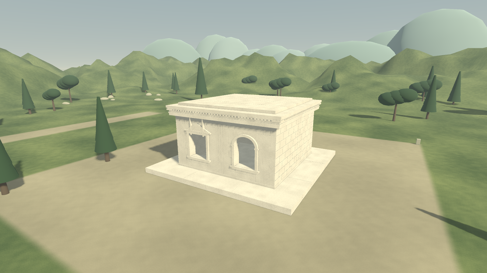

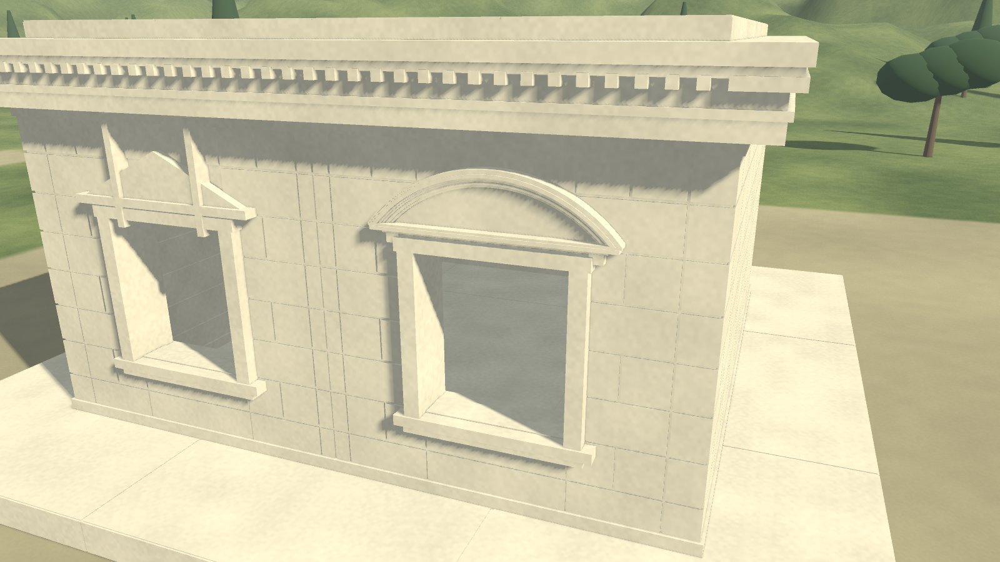

## Modular roofs and domes

The **Roofs** library filter replaces the single-size roof with **Terracotta Roof Slope** and **Stone Roof Slope**, each with a smaller **Half Slope** version. They rise **2.4 m per 4 m bay** and repeat in **4 m depth bays**.

| Piece | Width | Rise | Matches |
| --- | --- | --- | --- |
| Terracotta / Stone Roof Slope | 4 m | 2.4 m | Pediment left / right slope |
| Terracotta / Stone Roof Half Slope | 2 m | 1.2 m | Half of the original roof, small pediment or crown |

Aim at a matching **pediment's rear face** to start a roof. Behind a **crown**, attach two half slopes, turning one **180° with R twice**. Aim near a roof's **high or low edge** to continue its pitch, or at a **front/back edge** to extend the same piece along the building. **R** rotates each piece 90°; press it twice to build the opposite side. Two small halves form the original 4 m roof; large slope pairs form 8, 16 or wider roofs; large slopes with a small-half ridge fit 12, 20, 28 m modular pediments.

Modular pediments automatically widen to reach the **outer corners** of their supporting entablature run. The slopes, crown, backing and base share the same fit, keeping the diagonal continuous. A stone cap hides the roof’s tile thickness from the front; ridge finials rest above it. Saved positions and modular connections stay unchanged.

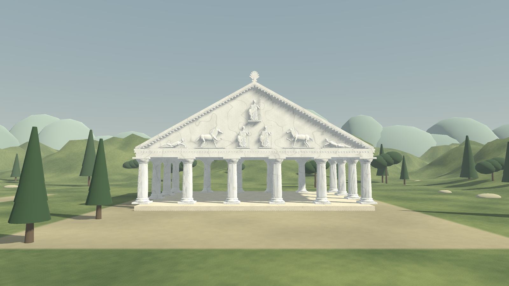

Gables stay on the building grid: a front and rear gable three depth bays apart are 12 m apart. Roof shells automatically cut back at attached gable ends to clear their stone cornices and ridge finials, while interior bays meet without gaps. The stack tool also repeats exact 4 m depth bays. Tile shells are solid but the attic underneath stays open. Existing saved whole roofs keep their original geometry; old hotbar assignments switch to **Terracotta Roof Half Slope**.

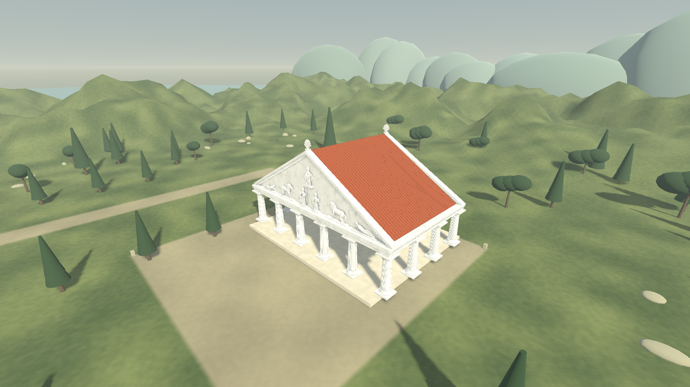

The **Stone Roof Slope** and **Stone Roof Half Slope** use broad slabs with recessed joints. They share the terracotta roofs' pitch, dimensions, pediment attachments, and stacking connections. Press **M** to match limestone, marble, or sandstone.

**Flat roof / ceiling** is a **4 × 4 m, 0.2 m thick** stone slab with a smooth underside and broad upper slab joints. It starts with a **front-edge anchor**, so its edge rests on the entablature and the cover extends into the room. **R** turns it inward from another side. **T** cycles front/back/right/left edges, four corners, then the centre; the HUD names the current anchor. Corner anchors can attach to beam endpoints. Aim at a slab's side to add the next 4 m tile, or use Stack for larger ceilings. The anchors also work on ground and with socket snapping disabled. **M** chooses the stone finish.

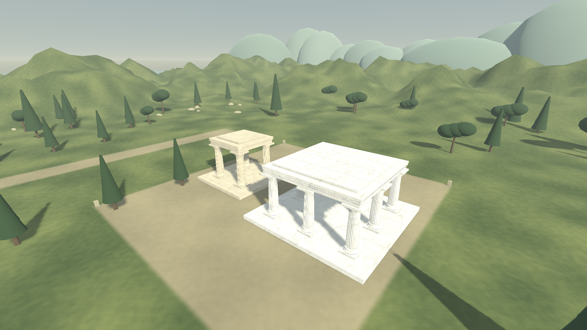

**Dome roof** covers a **4 × 4 m** room and rises **2.4 m**; **Grand dome roof** covers **8 × 8 m** and rises **4.4 m**. Both have hollow interiors, a short drum, and square coping that covers room corners. Aim at the top of a matching wall or entablature run to centre the dome over the room. **R** turns its attached edge; **T** cycles centre, edge, and corner anchors for other layouts. On foundations the default anchor is the centre.

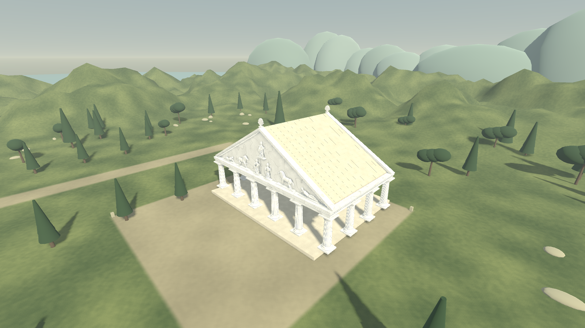

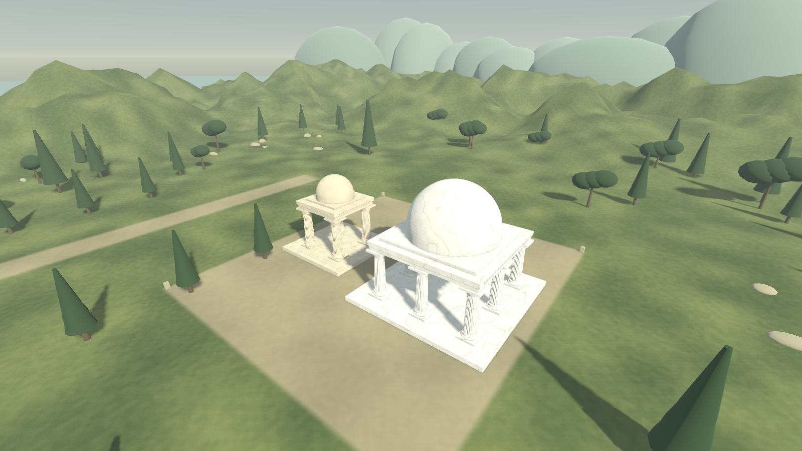

Flat ceiling panels automatically trim their mesh and collision where an edge meets a pediment, including modular backing and base courses. They retain their 4 m bay positions, so the final panel connects to its neighbours and the back of a large pediment without an overlap error. Build either part first; removing the pediment restores the full panel. This also works with the stack tool and existing saved buildings.

Flat ceilings also fit **under roof slopes**, so a square entablature ring can have two pediments, a complete sloped roof and a flat ceiling together. The ceiling tapers automatically beneath the low eaves while its underside stays level. Build the roof or ceiling first. With the roof already in place, aim at the **room-facing side of the entablature** to seat a ceiling at its top; **R** turns the panel inward and **T** cycles anchors. Extend from panel sides or use Stack to fill the remaining bays. Tiles also fit when the ceiling grid is offset by half a metre from the roof; aiming near a beam, pediment or slope follows the ceiling panels you already placed to fill a missing bay.

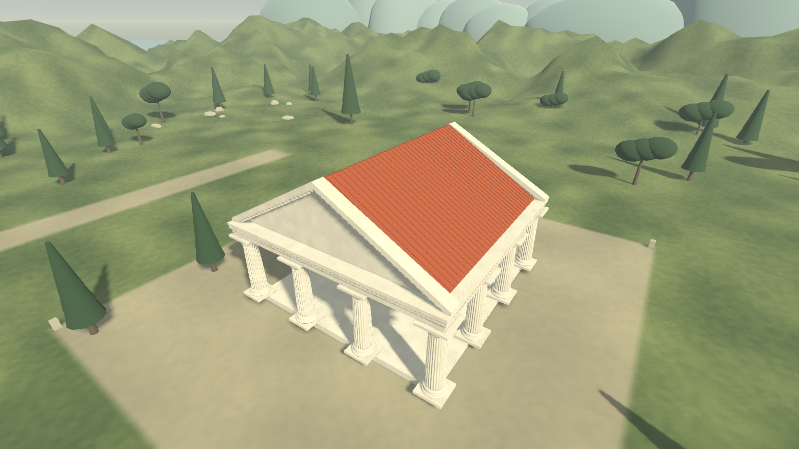

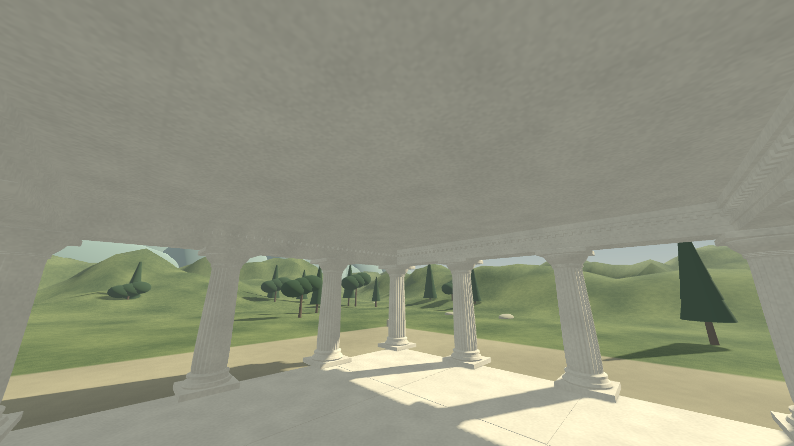

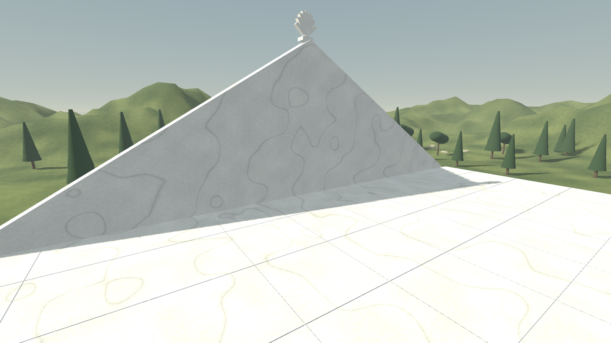

## Large pediments and sculpture

Open **E** and use the **Pediments** and **Sculpture** filters. Five new building blocks share four-metre bays: **Pediment left slope**, **Pediment right slope**, **Pediment crown**, **Tympanum backing**, and **Pediment base cornice**. The original complete four-metre pediment remains available. Connected slopes and crown ends continue the diagonal cornice and dentil spacing without notches; exposed eaves stay trimmed. Existing buildings update automatically on load.

1. Lay a run of base cornices over your temple's entablature.
2. Place a left slope at the left eave. Aim near its high end and place another left slope to continue **4 m across and 2.4 m up**. Flight makes the ends easier to reach.
3. Attach a crown at the summit, then continue down with right slopes. A crown with one slope on each side spans **12 m**; two slopes on each side span **20 m**, and three span **28 m**.
4. Stack **Tympanum backing** beneath the raised slopes and crown to fill the triangle. Each block is 4 m wide and 2.4 m high. Aim at an existing backing's side to extend a course, or its top/underside to add another course.
5. Equip a **Draped statue** or **Horse relief** and aim at the backing's recessed front. The preview reads **Sculpture recess** and places the carving clear of the stone behind it. Backing supports one large relief or two standing figures. **Reclining figures** attach inside the outer slopes; turn with **R** so their heads point uphill. Horses can also face either direction using R.

Sculptures use the selected stone finish and ordinary placement, demolition, undo/redo, and saves. They can also stand on other surfaces such as pedestals. Keep **C** snapping enabled and reset height with **Home** when using the recess attachments.

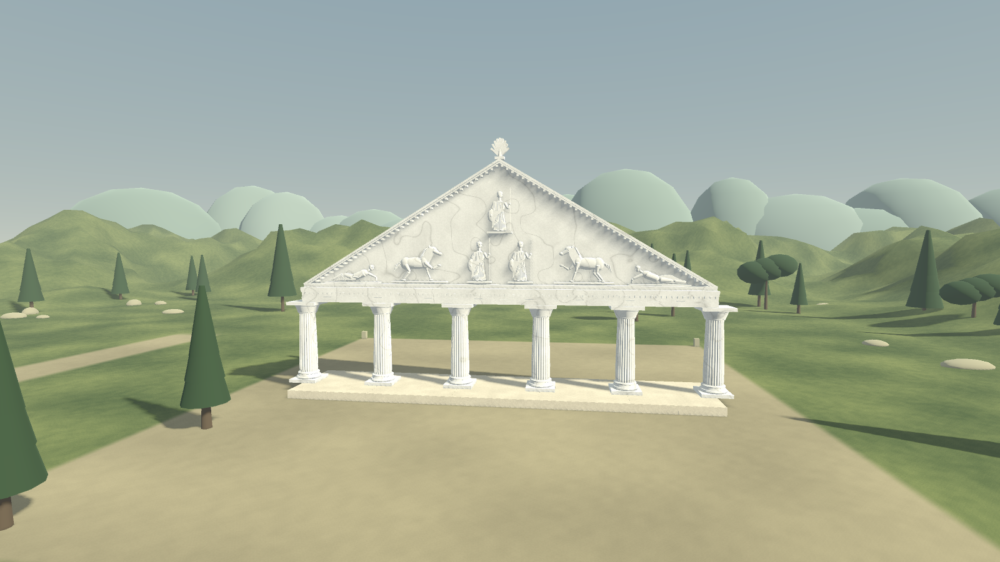

## Stack tool

Equip the dedicated **Stack tool** slot using the mouse wheel, **−** key, or the library hotbar. Hovering highlights the first point **red** and the second point **green**; selected parts keep a subtle tint, with muted red/green endpoints. **Left-click** the first component, then **right-click** the last component to lock the selection. The highlighted box includes components whose centres lie between the two endpoints, using the first piece's orientation. Individual outlines show exactly what will be copied. This lets you select a whole wall, column bay, or foundation assembly.

Look in the direction you want to repeat the selection, then scroll **forward** to repeat toward your view or **backward** to repeat in the opposite direction. The count passes through zero when switching sides. Look upward or downward to stack vertically; backward scrolling reverses that direction too. Direction follows the closest axis of the first piece, including vertical stacks and rotated layouts. Group spacing uses the combined dimensions, preserving every component's relative position, rotation, and finish. For a single-piece stack, select the same component with both clicks. Scrolling starts repeating only after both points are set.

The originals stay in place and do not count toward the preview count. **Left-click cancels; right-click confirms** all copies as one action. **Ctrl+Z** removes the entire confirmed batch; **Ctrl+Y** restores it. A coral preview explains a blocked stack, and nothing is placed until every component fits. Previews have no collision and are not saved.

Creative mode supports up to **32 repeated sets**, with a maximum of **256 preview components** in total; larger selections allow fewer sets. **Esc**, selecting another slot, or opening a menu cancels the tool. Ctrl+Z during selection or preview cancels the tool without undoing previous building. Confirmed copies remain ordinary saved components, so existing worlds stay compatible.

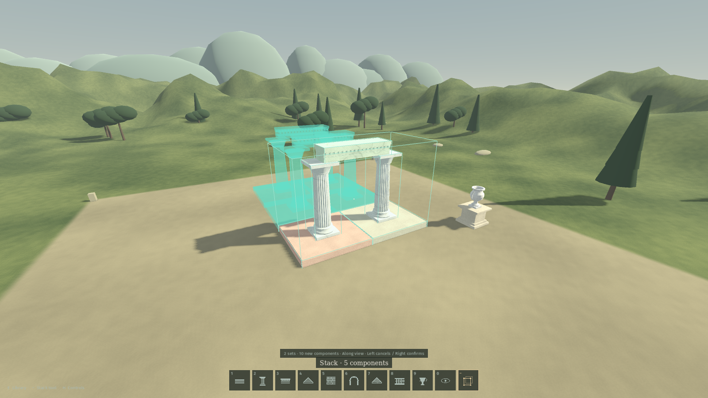

## Clean building corners

Ashlar walls, entablatures, dentil cornices, and balustrades automatically form **mitred 90° corners** with matching components. Lengths are measured along the centre line: meeting endpoints form the corner, while the visible mouldings extend and trim around it. Each span starts at four metres; **Auto** shortens it to the next matching endpoint or aligned column top when closing a 0.5–3.5 m gap, including the last side of a rectangle. **Comma / period** choose a fixed 0.5–8 m length, and **/** restores Auto. The HUD shows the actual length and **Fitted to gap** when a span closes a gap. Decorative details keep their proportions as the length changes. Balustrades share a single square corner post. The 0.5 m placement grid does not need to be changed.

1. Keep component snapping enabled (**C**).
2. Select the same component and rotate it **90° with R**.
3. Aim near the existing run's end. The preview reads **Mitred corner**, and the pieces fit together when placed.
4. If the preview extends the wrong way, rotate another **180°** or use **T** to choose its other end anchor. Rotation determines the extension direction, regardless of which side you view the corner from.
5. Continue around the room. The last side can connect to both existing corners and automatically fit the remaining distance. For a narrow layout, use comma / period to set the first side's length.

This works for inward and outward turns, larger rectangles, and layouts rotated relative to the world grid. Adding, removing, undoing, or loading a component updates neighboring joints automatically. Existing save files remain compatible; aligned endpoints receive the new joins on load. Previously misplaced or offset corner pieces should be re-placed using the new end snapping.

Automatic mitres connect matching wall profiles (including all three window styles) and the beam types above. Arches, roof hips, mixed-profile junctions, and T junctions need their own geometry rules; unrelated intersecting components still cannot be placed through each other.

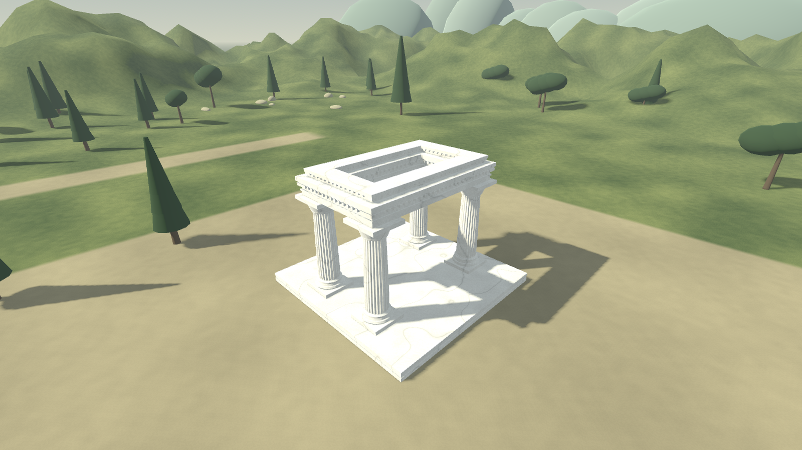

A green preview is valid; a coral preview explains why placement is blocked. Solid intersections, duplicate pieces, and placing a component through the player are rejected. Arch openings remain physically open. Pieces can float while experimenting; this prototype does not simulate structural collapse.

## Walls along foundation edges

Aim at the **top near an outside foundation edge** with a plain or window wall equipped. **R** turns it parallel to that edge. The wall's outer masonry snaps flush with the foundation; the preview automatically fits end bays so perpendicular walls close with proper mitres. Connected foundations share one perimeter, including stepped and L-shaped platforms. Window surrounds retain their normal decorative projection.

Keep grid/socket snapping enabled (**G/C**) and use **/** for automatic length fitting. The HUD shows **Flush foundation edge** and the exact fitted length. **Alt**, explicit lengths, manual height offsets, and **T** end anchors retain manual placement. Existing buildings stay in their saved positions.

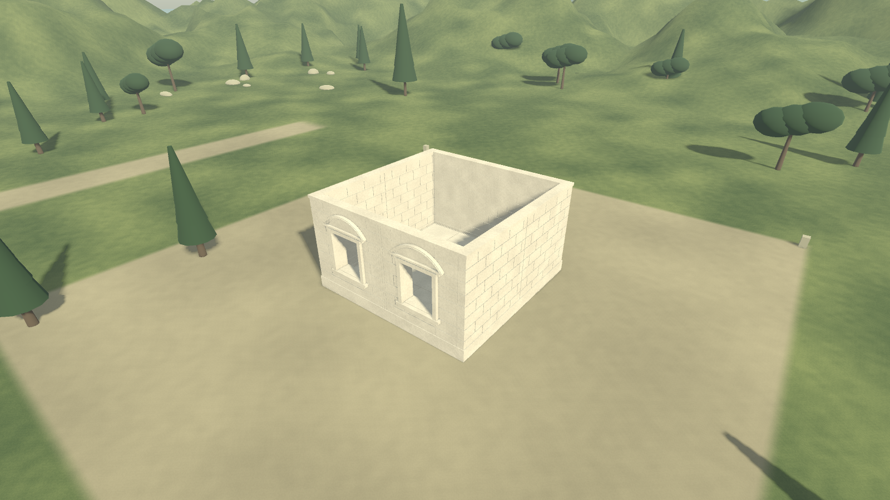

Double-tap W sprint requires two distinct presses within 0.3 seconds. Releasing W, pressing backwards, opening a menu/library, changing flight mode, loading a world, or losing focus clears sprint state.
